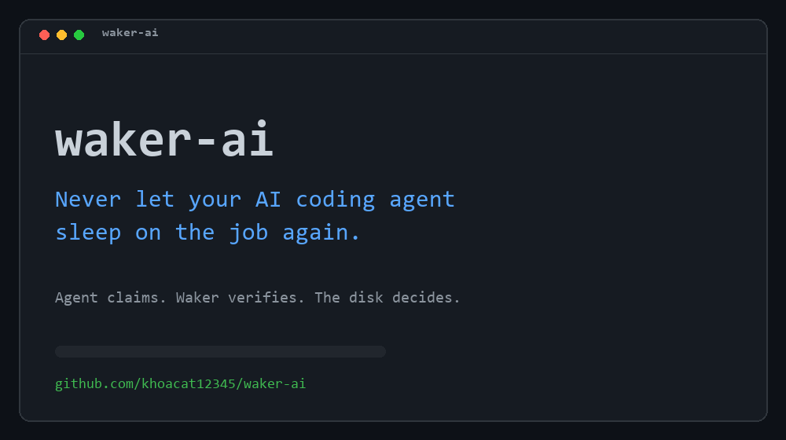

# waker-ai

[](https://github.com/khoacat12345/waker-ai/actions/workflows/ci.yml)
[](https://pypi.org/project/waker-ai/)
[](https://www.agensi.io/skills/waker-ai)



**Never let your AI coding agent sleep on the job again.**

`waker` is an independent supervisor for AI coding agents. It watches the disk
(not the agent's words), verifies a frozen contract, and wakes the agent up until
every task has on-disk evidence and every gate is green.

> Agent claims. Waker verifies. The disk decides.

```text
$ waker run --tasks .waker/tasks.yaml --adapter opencode --test "pytest -q"

**waker · run cff9c232 · 1/1 — 100%**
`████████████████`  ⏱ 00:45  🔁 0/5  🧪 PASS  💰 $0.0016

|   | Task | Work              | Evidence      | Gate |
|---|------|-------------------|---------------|------|
| ✅ | T1   | create live.txt   | src/live.txt  | pass |
```

## Why

AI agents do four things that ruin unattended runs:

1. **Stop early** — finish 1 of 5 tasks, exit 0, go quiet.
2. **Lie** — print "all tasks completed" while the test suite is red.
3. **Cheat** — edit the tests until they pass.
4. **Spin** — rewrite the same two lines five times with no progress.

Waker handles all four because it never trusts the agent's output. It only
trusts `git diff` and exit codes.

## Feature comparison

| Capability | Manual babysitting | `until` loop in bash | Agent built-in "auto" | **waker-ai** |
|---|:---:|:---:|:---:|:---:|
| Verifies work on disk (not claims) | ❌ | partial | ❌ | ✅ |
| Session resume across wakes | ❌ | ❌ | partial | ✅ T1 |
| Detects test tampering | ❌ | ❌ | ❌ | ✅ |
| Detects "claimed done, tests red" | ❌ | ❌ | ❌ | ✅ |
| Detects frozen / thrashing agents | ❌ | ❌ | ❌ | ✅ |
| Per-task checklist with evidence | ❌ | ❌ | partial | ✅ |
| Cost guard (USD) | ❌ | ❌ | ❌ | ✅ |
| Works with many CLIs | ❌ | ✅ | ❌ | ✅ T1/T2/T3 |
| Survives chatbox close (`--detach`) | ❌ | ✅ | ❌ | ✅ |
| Live TUI + web dashboard | ❌ | ❌ | ❌ | ✅ |
| Runs 100% offline for parsing/lint | ❌ | ✅ | ❌ | ✅ 0 token |

## Install

```bash
pip install waker-ai

# one command: detect installed CLIs and install the waker skill
waker setup

# Windows PTY tier-3 (optional)
pip install "waker-ai[pty]"
```

From source:

```bash
git clone https://github.com/khoacat12345/waker-ai
cd waker-ai
python -m venv .venv
.venv\Scripts\activate        # Windows
pip install -e ".[dev]"
pytest
```

## Quickstart (60 seconds)

```bash
# 0) detect the test runner already used by the repo
waker detect

# 1a) prompt with scope/verify -> contract (0 token, deterministic)
waker plan --prompt "Phase 1: auth, scope: src/auth/**, verify: pytest tests/auth -q"

# 1b) vague prompt -> one OpenCode planning turn writes the contract
waker plan --via opencode --model <provider/model> \
  --prompt "build an expense tracker app with login and Excel export"

# 2) validate the contract - fail closed on missing scope/verify
waker lint --tasks .waker/tasks.yaml

# 3) supervise the agent
waker run --tasks .waker/tasks.yaml \
  --adapter opencode --model opencode-go/deepseek-v4.1-flash \
  --test "pytest tests/ -q" \
  --max-kicks 5 --max-cost 0.50

# 4) after a crash/reboot, continue the same run
waker run --resume <run_id> --repo .
```

Background mode, then watch from anywhere:

```bash
waker start --detach --tasks .waker/tasks.yaml \
  --adapter opencode --model <provider/model> --test "pytest tests/ -q"

waker status --repo .
waker watch --repo .
waker dashboard --repo . --open
waker stop --repo .
```

Install the chatbox skill:

```bash
waker setup                          # detects OpenCode/Claude/Gemini, installs globally
# or explicit:
waker install-skill --for opencode --global   # ~/.opencode/skills/waker/SKILL.md
waker install-skill --for claude --global     # ~/.claude/skills/waker/SKILL.md
waker install-skill --for gemini --global     # ~/.gemini/config/skills/waker/SKILL.md
waker install-skill --for generic             # AGENTS.md block (idempotent)
```

Skills are loaded when the chat session starts — restart your CLI after
installing. A `pip install` cannot write into your agent's config by itself
(that is a security boundary); `waker setup` is the one-time post-install step.

## Blind evaluation (v1.1)

The Architect (chatbox) can write **hidden tests** that the worker never sees:

```bash
waker vault init --repo .
# → vault_id: 9f3a2c7d1e4b (the vault lives outside the repo)

waker vault add --vault 9f3a2c7d1e4b --suite auth --task T1 tests/test_auth_hidden.py
waker vault validate --vault 9f3a2c7d1e4b --repo .
# → fails on baseline? good. import error / skip / flaky? reject.

waker run --tasks .waker/tasks.yaml --vault 9f3a2c7d1e4b --adapter opencode ...
```

```yaml
- id: T1
  verify: "pytest tests/test_auth_smoke.py -q"   # public smoke, worker sees
  public_api: ["login(name, password) -> token | None"]
  blind:
    suite: auth
    baseline: red          # hidden must fail before work
    leak: message          # minimal | message
```

- `DONE` requires **100% hidden pass** plus public smoke and constraints.
- Failures are sanitized: `hidden://auth/test_3: AssertionError: ...`; no source,
  no paths, no locals.
- `VAULT_TAMPER` stops the run if the vault hash changes.
- **Honest scope:** v1.1 is blind by construction, not an adversarial sandbox.
  The worker runs as the same OS user; real isolation (Docker/Windows Sandbox)
  is v1.2. See [`docs/BLIND_EVALUATION_SPEC.md`](docs/BLIND_EVALUATION_SPEC.md).

## How done is decided

For every task:

```python
done(T) = (git diff ∩ T.scope ≠ ∅) and (T.verify exits 0)
```

| Gate | Stops |
|---|---|
| `scope ∩ diff` | touching an unrelated file to look busy |
| `verify` exit 0 | claiming success while tests are red |
| test hash | editing the exam (`TAMPER` → restore + kick) |
| contract hash | moving the goalposts mid-run |
| cost / kicks / wall clock | burning the budget in a retry loop |

## Adapters

| Tier | Mechanism | CLIs | Status |
|---|---|---|---|
| **T1** | native session resume | OpenCode (`run --session --format json`) | ✅ live E2E |
| **T1** | native session resume | Claude Code (`-p --resume --output-format stream-json`) | 🧪 beta (unit-tested, no live CI) |
| **T2** | fresh process + context digest | any CLI with a non-interactive flag (`aider --message`, `gemini -p`, custom commands) | ✅ |
| **T3** | PTY keystroke injection (ConPTY + pyte) | any text-mode TUI, even without a headless mode | ✅ Windows only |

`waker doctor` detects what is installed and prints the tier:

```text
$ waker doctor --inject-test
OK opencode      tier T1  (opencode 2.0.32)
OK claude        tier T1  (claude 1.x)
-- aider         tier -
OK any-text-cli  tier T3  (pywinpty)
injector self-test: PASS - marker seen
```

The injector self-test drives a harmless shell, never an AI session.

Importantly: **cost guard is exact only for OpenCode.** It reads
`opencode session export` before/after each turn. For Claude it uses the
`total_cost_usd` delta from the stream; for generic/PTY it is 0 (no measurement).

## Safety on Windows

- Every run is assigned to a **Win32 Job Object**
  (`JOB_OBJECT_LIMIT_KILL_ON_JOB_CLOSE`); `taskkill /T /F` is always issued as a
  fallback, so grandchildren die too.
- **Live freeze probe**: no stdout **and** no file activity for `--freeze-after`
  seconds → kill the tree and mark the turn `FROZEN`; no waiting for a
  15-minute timeout.
- Prompts are passed as argv, never through a shell (shell quoting corrupts
  prompts that contain quotes or backslashes).

## CLI

```text
waker plan        prompt -> contract (0 token, or --via opencode for vague prompts)
waker lint        contract validation (0 token)
waker detect      detect pytest / npm / cargo / go / make test
waker run         supervise in the foreground (--resume <id> to continue)
waker start       supervise in the background (detached)
waker stop        stop a run (tree kill)
waker serve       loopback HTTP control plane
waker status      markdown/JSON snapshot
waker watch       live Rich TUI
waker dashboard   static HTML or live web dashboard
waker report      print the acceptance report
waker doctor      environment + adapter tier + injector test
waker setup       detect CLIs and install the skill (one command)
waker install-skill  opencode / claude / gemini / generic
```

## Demo

The animated demo at the top is generated by
[`scripts/make_demo_gif.py`](scripts/make_demo_gif.py). The 45-second recording
script lives in [`docs/demo-45s.md`](docs/demo-45s.md).

## Design

Full design and decision log: [`plan.md`](plan.md).
Phase reports: `.waker/runs/phase1_report.md`, `phase2_report.md`, `phase3_report.md`.

## Status

**v1.1.2** - blind evaluation (hidden vault + sanitized grading), engine,
3 adapter tiers, daemon/skills, CI matrix, dashboard and release automation.

Maturity:

- **OpenCode T1** — live E2E verified.
- **Claude T1** — beta: command/stream/permission handling unit-tested, no live
  CI run yet (the CLI is not installed on the build runner).
- **PTY T3** — Windows only; POSIX support is planned for v1.1.
- **Cost guard** — exact for OpenCode, best-effort for Claude, 0 for generic/PTY.

PyPI: **published** — `pip install waker-ai` (v1.1.2).

## License

MIT
